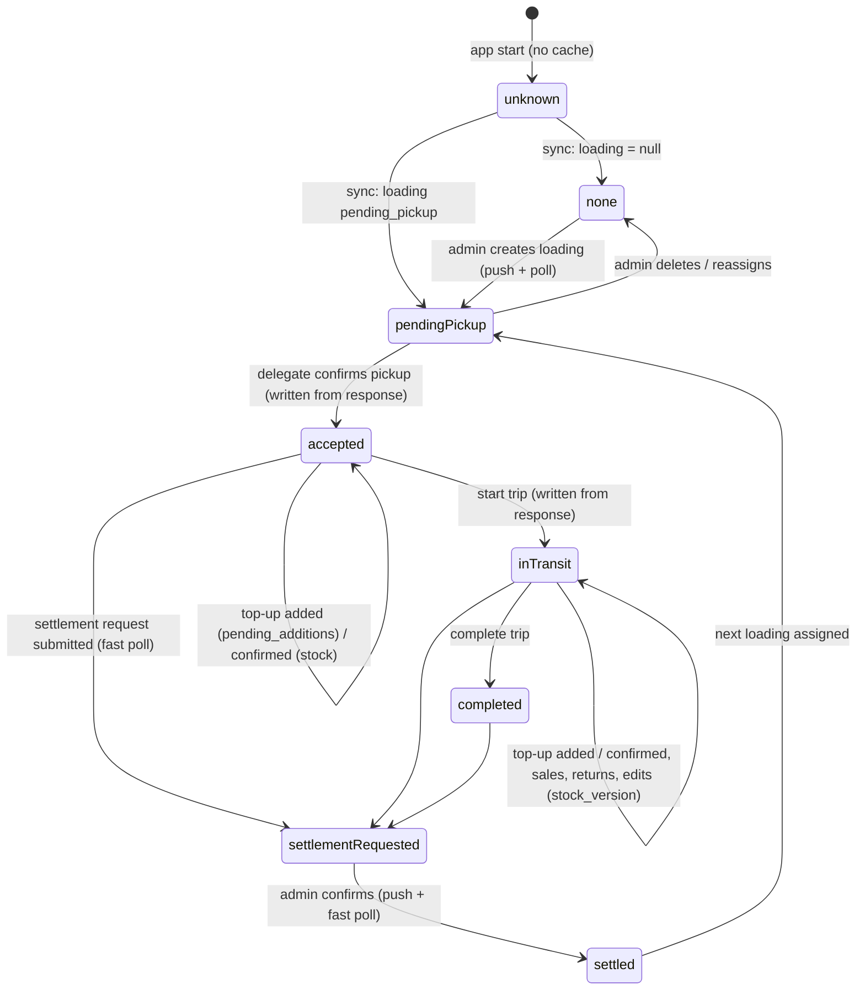

# Delegate state flow: loading / truck stock / settlement

Covers the reports *"no active loading shown right after receiving a shipment"*,
*"truck stock not updating"* and *"عمليات stuck on لا توجد تحميلة نشطة"*: why they
happened, and how the state is now kept in one place.

## 1. Audit (before this change)

| Screen | Where its data came from | Where staleness came in |
|---|---|---|
| `delegate_home_page.dart`, the page and the home tab's shipment card | `_HomeTab` dispatched its own `DelegateLoadingFetched` in `initState` and every 20 s (PollingMixin), seeded from `OfflineCacheService`, then copied the result up into the page's private `_loading` via `onLoadingChanged`. | `_loading` was updated **only** by `_HomeTab`'s own requests (RequestTracker drops every other answer). The poller paused while a route covered home (cc33d32) and on return just restarted the 20 s interval, with no immediate fetch. |
| Sell-tab gate (`_selectTab`, البيع/تسليم icons) | The page's private `_loading` (`_canSell`, `_hasActiveLoading`). | Same `_loading`, so the gate kept showing *"لا توجد تحميلة نشطة"* until home's own next poll. |
| `invoice_page.dart` (sell tab) | No loading state of its own; the product picker fetches sellable products (cache, then network) each time it opens. | Entry gated by the stale `_canSell` above. |
| `truck_stock_page.dart` | One `DelegateTruckStockFetched` in `initState`, seeded from the cache. | Kept alive forever in the `IndexedStack`, so the fetch never ran again. Only the manual refresh button updated it: **stock never updated after a sale, pickup or top-up.** |
| `transactions_page.dart` (عمليات) | `hasActiveLoading` passed in by home (= the stale `_canSell`); its own expense/collection lists refetched on `refreshTick`. | Banner *"لا توجد تحميلة نشطة حالياً — لا يمكن تسجيل…"* and disabled cards stuck until home's next successful poll. |
| `settlement_page.dart` | Its own shift-summary fetch + its own 20 s PollingMixin; a 404 meant "no shift". | Separate poller, separate notion of "active"; it never learned about a confirm-pickup done elsewhere until its own tick. |
| `loading_page.dart` | Its own fetch + 20 s poller, seeded from the cache; confirm / status / top-up answers updated only its local `_currentLoading`. | Results stayed local: home never saw the confirm (and LoadingPage `pushReplacement`s itself away right after). |
| `invoice_history_page.dart` | Fetch in `initState` + on `refreshTick` (tab re-selected). | Not refreshed after the offline queue delivered a sale, or after an edit made elsewhere, until the tab was re-selected. |
| `dashboard_section.dart` | One fetch in `initState` (cache first) + a manual retry. | Month totals never refreshed after a sale for the whole session. |
| `OfflineCacheService` / `DelegateRepositoryImpl` | `current_loading` was written **only** by `getCurrentLoading()`. | `confirmLoading()` / `updateLoadingStatus()` returned the fresh loading but never cached it, so the cached snapshot stayed `pending_pickup` after a successful pickup. |

### Root causes found

1. **The loading state lived in a private widget field that only one widget's own request could update.**
   `DelegateHomePage._loading` was fed exclusively by `_HomeTab`'s tracked fetch. A confirm-pickup done in
   `LoadingPage` produced `DelegateLoadingConfirmedState` on the shared bloc, but `_HomeTab` ignored it (not its
   requestId). So the sell tab, the تسليم gate and the عمليات banner all still said *"no active loading"*
   after a successful pickup, until `_HomeTab`'s next poll. **This was the main bug.**
2. **The polling made it worse.** It ran every 20 s, was paused while `LoadingPage` covered home, and on return
   only restarted the timer (no immediate fetch). After confirming, the delegate could wait up to 20 s.
3. **`initState`-only fetches on tabs that are never rebuilt.** `TruckStockPage` (and `DashboardSection`)
   fetch once and then live forever in the `IndexedStack`, which is why truck stock didn't update.
4. **Stale cache after pickup.** The confirm and status-change responses weren't written to the
   `current_loading` cache, so a cold or offline start showed the shipment as still pending and blocked
   selling.
5. **Four separate pollers** (home, LoadingPage, SettlementPage, each 20 s and each with its own idea of
   "active") instead of one source. Each screen could disagree with the others.

The "cache can write none" rule itself was already right (`getCurrentLoading()` clears the slot only on a
successful `data: null` answer). It is kept, and is now the only path that can produce "none".

## 2. Now: one `DelegateSyncService`

`lib/features/delegate/presentation/sync/delegate_sync_service.dart`, registered in `service_locator`, and
exposed through `DelegateSyncScope` *above* the MaterialApp's Navigator, so pushed routes see it too.

State: `activeLoading`, `lifecycle` (enum below), `pendingAdditions`, `settlementState`, `stockVersion`,
`truckStock`, `hasSyncedOnce`, `lastSyncFailed`, `revision`.

**Backend probe:** `GET /v1/mobile/delegate/sync-state` (ETag / If-None-Match → 304). The service refetches
only what moved: `GET /delegate/loading` if the loading ref or the pending-addition ids changed, and
`GET /delegate/truck-stock` (plus sellable products, best effort) if `stock_version` changed.

**Polling:** every **8 s** while the app is in the foreground and a delegate is signed in; paused in the
background. **3 s** for up to **2 min** after a settlement request is submitted, while the request is pending.

**Immediate sync triggers:**
- app resume
- connectivity regained
- the offline queue delivering an action
- a tab being selected (`_selectTab`) and TruckStockPage opened as a route
- every local mutation seen on the shared `DelegateBloc`: confirm pickup, start trip / complete, confirm
  top-up, invoice create / edit, expense, collection (and their edit / delete), settlement submit
- an FCM data message `{type, loading_id}` (`loading_created | loading_updated | loading_deleted |
  loading_addition | settlement_confirmed`)

Concurrent triggers coalesce into one in-flight probe plus at most one follow-up.

**Immediate write-through:** any bloc state that carries the full loading (`DelegateLoadingConfirmedState`,
`DelegateLoadingStatusUpdated`, `DelegateLoadingAdditionConfirmedState`, `DelegateLoadingLoaded`) is applied
at once. No waiting for a poll.

**Rules:**
- *"No loading"* is reported only after a successful server answer said so. Before the first sync the
  lifecycle is `unknown` and the UI shows a skeleton.
- A failed or offline sync never changes the state. It sets `lastSyncFailed`, which drives the existing
  offline banner, and the last known shipment stays on screen.
- The cache only seeds the state at start-up (marked stale) and can never override a later server answer.
- User actions keep their `RequestTracker` flow. The service only observes their outcomes.

**Screens now:**
- **Home card:** state-specific: skeleton → *لا توجد شحنة* / *عندك شحنة جديدة بانتظار الاستلام* (+ *مراجعة
  وتأكيد الاستلام*) / active / in transit / completed / *بانتظار تأكيد التسليم من الإدارة* / *تمت تسوية
  الشحنة*.
- **Sell gate and عمليات banner:** both use `sync.canSell`.
- **Truck stock:** reads `sync.truckStock`.
- **LoadingPage:** reads `sync.activeLoading`. Its private poller is gone.
- **Settlement, invoice history, dashboard:** refetch their own lists when `sync.revision` moves
  (`DelegateSyncRefetchMixin`). SettlementPage's private poller is gone.
- **Pull-to-refresh** remains as a fallback only.

## 3. Lifecycle

| Transition | Server field that moves | Screens that change |
|---|---|---|
| Loading created / edited / deleted / reassigned | `loading` (created / `updated_at` via `touch()` / null) | Home card, sell & تسليم gates, عمليات banner, LoadingPage |
| Confirm pickup | `loading.status`, `stock_version` | All of the above + truck stock, sellable products |
| Start trip / complete | `loading.status` | Home card, gates, عمليات, LoadingPage |
| Top-up added | `pending_additions.ids`, `loading.updated_at` | Home card notice, LoadingPage confirm card |
| Top-up confirmed | `pending_additions`, `stock_version` | Notice disappears; truck stock, sellable products |
| Sale / return / invoice edit | `stock_version` | Truck stock, invoice history, dashboard, settlement summary |
| Settlement request submitted | `settlement_request` (pending) | Home notice *بانتظار تأكيد التسليم*, settlement page |
| Settlement confirmed | `loading` → null, `settlement_request` confirmed, `stock_version` | Home *تمت تسوية الشحنة*, gates closed, settlement page "confirmed", truck stock empty |

Backend mutation audit (see `DelegateSyncStateTest`): every path above moves a field the probe hashes.

Two paths didn't before this change:
- Admin item edit: `update()` was a no-op on the loading row → now `touch()`.
- Top-up added / confirmed: only the addition row changed → now `touch()` on the loading.

`stock_version` hashes every `product_id:qty` pair plus `MAX(updated_at)`. A first version that summed
quantities missed a `+1` / `−1` pair inside the same second; the test caught it. (MySQL's default
`group_concat_max_len` of 1024 covers roughly 80 products per truck; beyond that `MAX(updated_at)` still
moves.)

## 4. Push (accelerator only)

`SendDelegateSyncPush` is a data-only FCM message, dispatched with `dispatchAfterResponse()`. It is sent on
loading create / edit / delete / reassign, top-up added, and settlement confirmed.

It never blocks or fails the admin action: errors are caught and logged. **iOS** has no APNs setup (no paid
Apple Developer account), so iOS devices rely on the 8 s polling alone.
